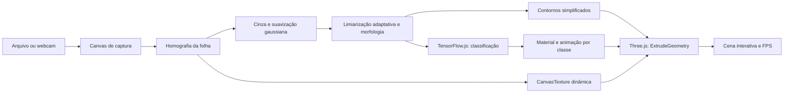
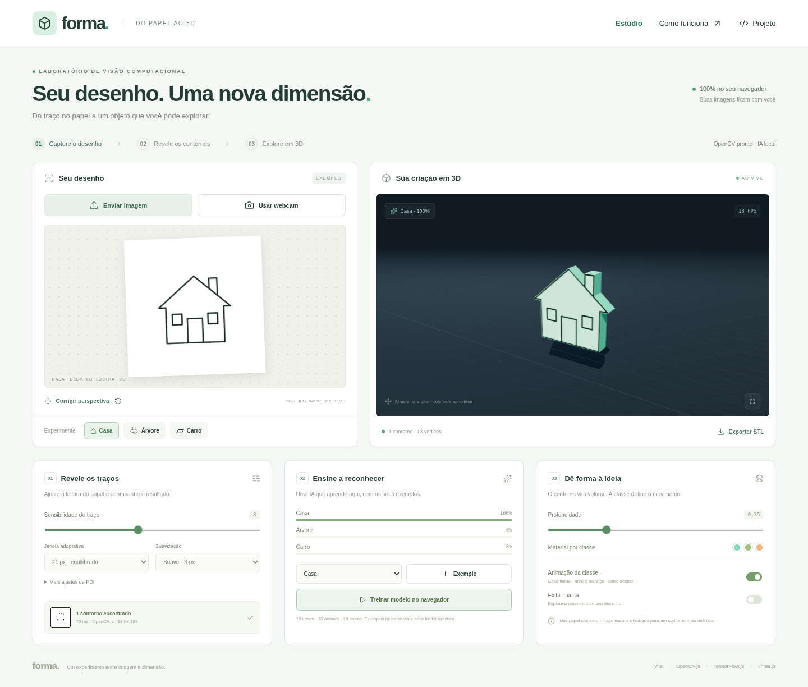

# Forma — Digitalizador de desenhos 3D

Projeto do tema 1 da atividade N2 de **Processamento Digital de Imagens e Computação Gráfica**: transformar um desenho feito no papel em uma geometria 3D, usando **Vite, OpenCV.js, TensorFlow.js e Three.js**, inteiramente no navegador.

A fotografia é corrigida por homografia e segmentada; seus contornos geram a malha extrudada. Um classificador treinado no navegador reconhece **casa, árvore ou carro**, e sua saída controla o material e a animação do objeto. A geometria vem do desenho processado, não de um modelo 3D escolhido por nome.

## Equipe e entrega

| Campo | Informação |
| --- | --- |
| Integrante 1 | Leonardo Felipe Roncolato |
| Integrante 2 | Mickael Lopes Mendes |
| Turma / instituição | A preencher |
| Professor indicado no enunciado | Daniel Corrêa Da Silva |
| Repositório | https://github.com/leoroncolato/pdi-digitalizador-3d |
| Aplicação publicada | Pendente de publicação |
| Vídeo de 3–5 minutos | [Demonstração legendada — 3min30s](docs/demonstracao.mp4) |
| Entrega / apresentação | Datas ainda não definidas no enunciado |

Equipe em dupla. Manter contribuições reais de ambos os integrantes no histórico Git. A demonstração legendada já foi gerada. A dupla deve revisar o vídeo e complementar com exemplos próprios; a publicação do site e a apresentação ainda precisam ser confirmadas.

## Executar

Requisitos: Node.js 22.12+ ou versão LTS mais recente compatível com o Vite, npm e um navegador atual com WebGL. O projeto foi iniciado pelo template `vanilla` do `npm create vite@latest`.

```bash
git clone https://github.com/leoroncolato/pdi-digitalizador-3d.git
cd pdi-digitalizador-3d
npm install
npm run dev
```

Abrir o endereço informado pelo Vite. Para instalação reproduzível com o lockfile já existente, usar `npm ci`.

```bash
# Compilar a aplicação estática
npm run build

# Servir o resultado de dist/ localmente
npm run preview

# Testes de geometria
npm run test:geometry

# Testes de integração no navegador
npx playwright install chromium
npm test

# Repetir a suíte contra o build de produção (inclui build)
npm run test:production
```

O servidor do Vite serve arquivos durante o desenvolvimento; **não existe back-end de processamento**. Captura, homografia, segmentação, treinamento, inferência e renderização acontecem no navegador. A webcam requer permissão e contexto seguro: `localhost` ou HTTPS. Um endereço HTTP da rede local não satisfaz essa exigência apenas por usar `--host`.

## Usar o digitalizador

1. Experimente uma imagem de demonstração para conhecer o fluxo; depois importe uma foto ou autorize a webcam.
2. Use papel claro, traço escuro e boa iluminação. Enquadre a folha inteira, evitando sombras fortes e reflexos.
3. Ajuste os quatro cantos da folha na ordem indicada na interface. A homografia transforma o quadrilátero em uma imagem retificada quadrada; a proporção física original do papel não é estimada. Os cantos são definidos manualmente; a aplicação não promete detectar automaticamente qualquer folha.
4. Ajuste a limiarização, a suavização e a filtragem de contornos. Confira a máscara para separar o desenho do fundo antes de avaliar o resultado 3D.
5. Observe a geometria produzida pelos contornos, altere a profundidade e navegue com o mouse ou toque: orbitar, aproximar e deslocar a câmera.
6. Acrescente exemplos rotulados de casa, árvore e carro e treine o classificador. Teste uma imagem que não foi usada no treinamento; observe a classe e a confiança, além das mudanças de material e animação.
7. Acompanhe o FPS exibido. Para a entrega, repita o teste no computador do laboratório, inclusive com webcam e inferência ativas.

### Treinamento e limites da IA

O classificador usa TensorFlow.js e aprende no navegador a partir de máscaras binárias centralizadas e normalizadas em 24 × 24 pixels. Uma camada densa de 48 unidades ReLU alimenta uma saída softmax de três classes. O treinamento usa Adam e 45 épocas. Os exemplos e o modelo ficam na sessão atual; recarregar a página reinicia esse estado. Há exemplos sintéticos para permitir uma primeira experiência sem coleta prévia. Eles são dados de demonstração: não comprovam a qualidade do classificador em desenhos reais.

Para uma avaliação honesta, reunir desenhos de diferentes pessoas, manter quantidade semelhante por classe e separar **treino** e **teste** antes de adicionar exemplos. Incluir variações de posição, proporção, traço, papel e iluminação. Não incluir no treinamento as imagens usadas para reportar resultados. Registrar quantidade por classe, acertos, erros e uma matriz de confusão. A confiança da rede não é uma garantia de acerto, especialmente para classes desconhecidas.

O problema é de classificação entre três classes conhecidas. Um barco, uma pessoa ou uma imagem sem desenho pode receber uma dessas classes; isso não significa que o modelo reconhece objetos em geral. O modelo não recupera a profundidade física do objeto: o resultado é uma **extrusão 2,5D** dos contornos da imagem. São extrudadas as silhuetas externas (`RETR_EXTERNAL`); buracos internos, como janelas e o interior de rodas, não viram vazios na malha. Contornos abertos, linhas muito finas e regiões desconectadas exigem ajustes e podem produzir fragmentos. A seleção limita a geometria aos 24 maiores contornos válidos para controlar o custo de renderização.

## Pipeline integrado



O PDI define os vértices das formas extrudadas; a imagem processada fornece a textura dinâmica; a inferência define a aparência e o movimento. O loop gráfico permanece independente da frequência de processamento das imagens para evitar refazer a malha a cada quadro renderizado.

### Técnicas de PDI

| Categoria | Operação | Finalidade / parâmetros |
| --- | --- | --- |
| Transformação geométrica | `getPerspectiveTransform` e `warpPerspective` | Retificar a folha com quatro cantos normalizados |
| Conversão de cor | `cvtColor` para tons de cinza | Reduzir os canais usados na segmentação |
| Suavização | `GaussianBlur` | Atenuar ruído antes da segmentação; tamanho do kernel |
| Limiarização | `adaptiveThreshold` | Separar tinta e papel com limiares locais; janela e constante C |
| Morfologia | Fechamento morfológico | Unir pequenas falhas no traço; tamanho do kernel |
| Análise de formas | `findContours` e `approxPolyDP` | Extrair e simplificar polígonos; área mínima e tolerância |

Os parâmetros são acessíveis pela interface. O OpenCV é servido como asset local do pacote npm (`?url`), evitando a incompatibilidade do export Promise UMD com o empacotamento CommonJS. Ele só é utilizado depois de sua inicialização; objetos nativos temporários são liberados com `delete()`. O TensorFlow usa `tf.tidy()` e descarte explícito para tensores e modelos. As geometrias, materiais e texturas substituídos também precisam ser descartados no Three.js.

## Organização

```text
pdi-digitalizador-3d/
├── index.html
├── package.json
├── package-lock.json
├── vite.config.js
├── public/
│   └── assets/
├── src/
│   ├── main.js                 # inicialização e integração do pipeline
│   ├── capture.js              # captura de imagem e webcam
│   ├── ui.js                   # interação, parâmetros e indicadores
│   ├── samples.js              # desenhos sintéticos para demonstração
│   ├── style.css
│   ├── vision/
│   │   ├── opencv.js           # inicialização e operações de PDI
│   │   └── model.js            # exemplos, treinamento e inferência
│   └── scene/
│       ├── scene.js            # câmera, luzes, controles e renderização
│       └── objects.js          # geometria, material e animação
├── tests/                     # verificações no navegador
└── docs/
    ├── REQUISITOS.md           # rastreabilidade e checklist da entrega
    ├── APRESENTACAO.md         # roteiro de vídeo e apresentação
    └── screenshots/
```

Não é necessário baixar um modelo pré-treinado de `@tensorflow-models`: neste tema, o modelo é criado e treinado com `@tensorflow/tfjs` no próprio navegador.

## Captura de tela



## Publicação no GitHub Pages

1. Enviar o código e o lockfile ao repositório indicado, preservando os commits reais da equipe.
2. No GitHub, abrir **Settings → Pages → Build and deployment → Source → GitHub Actions**.
3. Executar o workflow de publicação ou enviar um commit para a branch configurada no workflow.
4. Aguardar a compilação e a publicação. Abrir a URL fornecida pelo GitHub e repetir o fluxo com uma imagem própria.
5. Preencher o link da aplicação na tabela de entrega e conferir que recursos, OpenCV e webcam carregam sob HTTPS.

O Vite usa `base: './'`, gerando caminhos relativos compatíveis com a publicação deste aplicativo estático em um subdiretório do Pages. Caso se adote uma base absoluta, usar `/pdi-digitalizador-3d/` para este repositório; para outro repositório, ajustar o nome. O artefato publicado é `dist/`; não se deve publicar `node_modules/`.

Salvar arquivos ou preparar o workflow não publica a aplicação automaticamente sem envio ao GitHub e execução bem-sucedida da hospedagem.

## Validação e entrega acadêmica

Resultados executados: [relatório de validação](docs/VALIDACAO.md).

Consultar [a matriz de requisitos](docs/REQUISITOS.md) e [os roteiros de apresentação](docs/APRESENTACAO.md). A meta de **15 FPS ou mais** deve ser medida no computador do laboratório. Resultados de automação em navegador sem GPU dedicada não substituem essa medição.

A revisão do vídeo, os dados reais de avaliação do classificador, o histórico de contribuições e a apresentação são partes da entrega que precisam ser concluídas pela equipe. Não há promessa de nota nem de atendimento a critérios dependentes da demonstração antes dessa validação.

## Autoria, assistência e referências

O desenvolvimento deste projeto contou com assistência de **OpenAI Codex / ChatGPT**, uma ferramenta de IA generativa, para implementação, documentação e apoio à validação. Essa assistência é declarada conforme as regras da atividade. A equipe deve revisar o código, adaptar o trabalho quando necessário e compreender as decisões e limitações; cada integrante pode ser questionado sobre qualquer módulo.

O ponto de partida foi o template oficial `vanilla` do Vite. As bibliotecas abaixo são dependências externas e mantêm suas próprias licenças. Os exemplos sintéticos são material de demonstração gerado no projeto, não um conjunto de dados científico nem desenhos coletados da equipe.

- [Enunciado](docs/REQUISITOS.md): “N2 — Processamento Digital de Imagens e Computação Gráfica”, atividade de laboratório disponibilizada pelo professor.
- [Vite — documentação](https://vite.dev/guide/)
- [Three.js — documentação](https://threejs.org/docs/)
- [ExtrudeGeometry](https://threejs.org/docs/#api/en/geometries/ExtrudeGeometry)
- [OpenCV.js — tutoriais](https://docs.opencv.org/4.x/d5/d10/tutorial_js_root.html)
- [Pacote OpenCV.js para npm](https://github.com/TechStark/opencv-js)
- [TensorFlow.js — documentação](https://www.tensorflow.org/js)
- [TensorFlow.js — treinamento no navegador](https://www.tensorflow.org/js/guide/train_models)
- [Playwright — documentação](https://playwright.dev/docs/intro)

## Gerar capturas e vídeo de demonstração

Com o preview em execução, `APP_URL=http://127.0.0.1:4173 node scripts/capture-preview.mjs` salva capturas desktop e móvel. `scripts/record-demo.mjs` grava interações reais com legendas em português; requer Chromium e FFmpeg (`npx playwright install chromium ffmpeg`, além de `ffmpeg` no PATH). Configure `VIDEO_OUTPUT` com o caminho do MP4 desejado. Na máquina de desenvolvimento sem navegador Playwright instalado, pode-se informar `PLAYWRIGHT_CHROMIUM_EXECUTABLE_PATH=/usr/bin/chromium`.

A gravação automatizada é uma demonstração técnica legendada, sem narração da dupla. Revisem e complementem com exemplos próprios antes da submissão.
